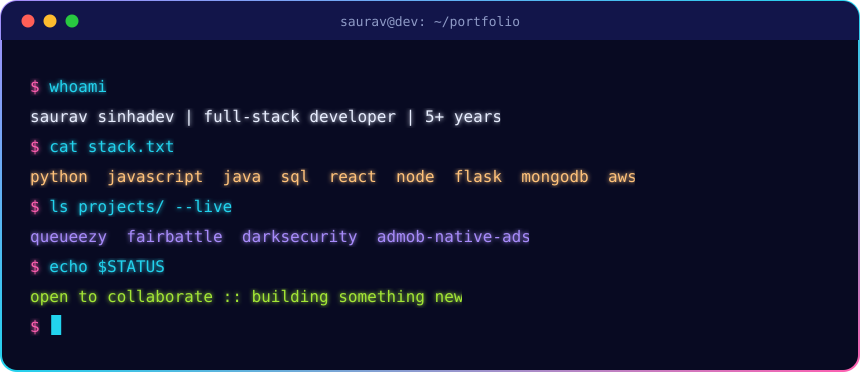
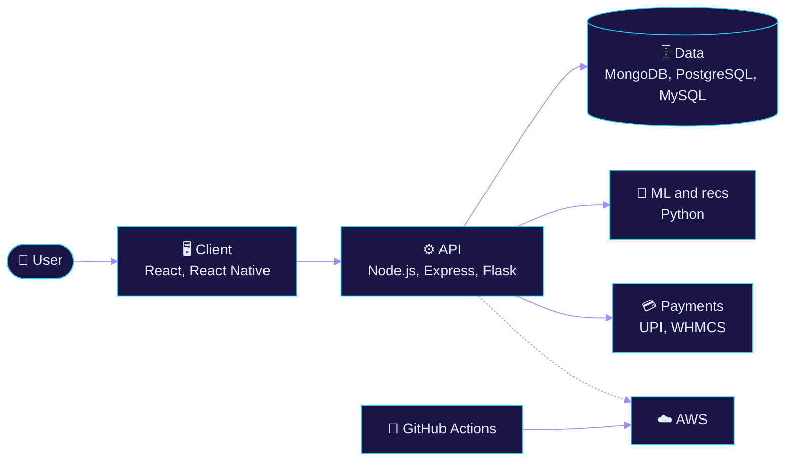

<!--
  Profile README for github.com/sauravsinhadev
  1) Repo must be PUBLIC and named exactly: sauravsinhadev  (sauravsinhadev/sauravsinhadev)
  2) Upload the assets/ folder (hero.svg, terminal.svg, divider.svg) to the repo root on branch "main"
  3) Put snake.yml at .github/workflows/snake.yml and run it once from the Actions tab
-->

<div align="center">



<br>


[](https://linkedin.com/in/sauravsinhadev)
[](https://twitter.com/sauravsinhadev)
[](https://github.com/sauravsinhadev?tab=followers)

<br>



</div>


## `$ cat about.ts`

```ts
const saurav = {
  role: "Full-stack developer",
  experience: "5+ years",
  buildingNow: ["Queueezy: AI quiz and learning platform"],
  learning: ["recommendation systems", "embeddings", "ranking"],
  shipped: ["Discord security bot", "React Native AdMob package", "UPI payment SDK"],
  alsoDo: ["open source", "tech writing", "mentoring"],
  openToCollaborate: true,
} as const;
```

> [!NOTE]
> **Open to collaborate.** If you have an idea, a bug that won’t quit or a project that needs a full-stack hand, message me on [LinkedIn](https://linkedin.com/in/sauravsinhadev).


## `$ ls ./projects --featured`

| | Project | What it does | Stack | Status |
|:-:|:--|:--|:--|:-:|
| 🧠 | [**Queueezy**](https://queueezy.in/) | AI quiz platform for exam prep: practice tests, leaderboards, analytics, auth and smart question recommendations. | `AI` `Auth` `Analytics` | 🟡 In progress |
| 🏆 | [**Free Fire Tournament Platform**](https://fb.fairbattle.in/) | Esports tournaments: team registration, brackets, match scheduling, result verification, prize tracking and an admin dashboard. | `Full-stack` `Brackets` | 🟢 Live |
| 🛡️ | [**DarkSecurity**](https://discord.com/discovery/applications/1329507405264060426) | Discord security bot: anti-spam, anti-raid detection, auto moderation, activity monitoring and audit logging. | `Discord` `Security` | 🟢 Live |
| 📱 | [**React Native AdMob Native Ads**](https://fb.fairbattle.in/) <!-- TODO: replace with this package's own repo or npm link --> | AdMob Native Ads package with full customization, built for React Native 0.85+ and TypeScript-first. | `React Native` `TypeScript` | 🟢 Live |
| 🧬 | [**SynapseRec**](https://github.com/sauravsinhadev/Recomendation) | Recommender covering embeddings, similarity, session-aware suggestions and ranking. | `Python` `Flask` | 🔵 Learning |
| 📰 | [**AI News Hub**](https://github.com/sauravsinhadev/ai-news-hub) | News aggregation with personalized recommendations and multilingual support. | `AI` `i18n` | 🟡 In progress |

<details>
<summary><code>$ ls ./projects --all</code> &nbsp;(7 more)</summary>

<br>

| Project | What it does | Stack | Status |
|:--|:--|:--|:-:|
| [**PaglaUPI WHMCS Gateway**](https://github.com/sauravsinhadev/paglaupi-whmcs) | Custom WHMCS payment gateway with order verification, webhook handling and automated invoices. | `WHMCS` `Webhooks` | ⚪ Built |
| [**UPI Payment SDK**](https://github.com/sauravsinhadev/react-native-upi) | Google Pay, PhonePe and BHIM UPI workflows for React Native. | `React Native` `UPI` | ⚪ Built |
| [**Discord Auto Shop Bot**](https://github.com/sauravsinhadev/discord-auto-shop) | Automated digital product delivery with stock management and transaction verification. | `Discord` `Automation` | ⚪ Built |
| [**AI Customer Support Chatbot**](https://github.com/sauravsinhadev/ai-support-chatbot) | Chatbot for automated customer assistance and ticket handling. | `Node.js` `AI` | ⚪ Built |
| [**Deal Discovery Platform**](https://github.com/sauravsinhadev/deal-finder-ai) | Community deal sharing with AI recommendations and price tracking. | `AI` `Community` | 🟡 In progress |
| [**Gama567 Mobile Platform**](https://github.com/sauravsinhadev/gama567) | Android gaming app with responsive UI, authentication and real-time content. | `Android` `Auth` | ⚪ Built |
| [**Realtime Chat**](https://github.com/sauravsinhadev/chats/tree/main) | WhatsApp-style realtime chat over socket connections. | `Sockets` `Realtime` | ⚪ Built |

</details>

<sub>🟢 Live &nbsp;|&nbsp; 🟡 In progress &nbsp;|&nbsp; 🔵 Learning &nbsp;|&nbsp; ⚪ Built</sub>


## `$ cat stack.json`

<div align="center">
<picture>
  <source media="(prefers-color-scheme: dark)" srcset="https://skillicons.dev/icons?i=python,js,java,mysql,react,html,css,bootstrap,nodejs,flask,express,mongodb,postgres,aws,git,githubactions&perline=8&theme=dark">
  <source media="(prefers-color-scheme: light)" srcset="https://skillicons.dev/icons?i=python,js,java,mysql,react,html,css,bootstrap,nodejs,flask,express,mongodb,postgres,aws,git,githubactions&perline=8&theme=light">
  
</picture>
</div>

```json
{
  "languages": ["Python", "JavaScript", "Java", "SQL"],
  "frontend":  ["React", "HTML5", "CSS3", "Bootstrap"],
  "backend":   ["Node.js", "Flask", "Express"],
  "databases": ["MongoDB", "PostgreSQL", "MySQL"],
  "tools":     ["Git", "AWS", "GitHub Actions"],
  "other":     ["Machine Learning", "REST APIs"]
}
```

### `$ ./how-i-build.sh`




## `$ git stats --all`

<!--
  These cards come from the public github-readme-stats and github-readme-activity-graph instances,
  which can show a rate-limit error at busy times. If that happens, delete this section or self-host them.
  The rest of the page does not depend on it.
-->

<div align="center">
<picture>
  <source media="(prefers-color-scheme: dark)" srcset="https://github-readme-stats.vercel.app/api?username=sauravsinhadev&show_icons=true&include_all_commits=true&hide_border=true&theme=transparent&title_color=22d3ee&text_color=c9d1d9&icon_color=ff5fb0">
  <source media="(prefers-color-scheme: light)" srcset="https://github-readme-stats.vercel.app/api?username=sauravsinhadev&show_icons=true&include_all_commits=true&hide_border=true&theme=transparent&title_color=7c3aed&text_color=24292f&icon_color=db2777">
  
</picture>
<picture>
  <source media="(prefers-color-scheme: dark)" srcset="https://github-readme-stats.vercel.app/api/top-langs/?username=sauravsinhadev&layout=compact&langs_count=6&hide_border=true&theme=transparent&title_color=22d3ee&text_color=c9d1d9">
  <source media="(prefers-color-scheme: light)" srcset="https://github-readme-stats.vercel.app/api/top-langs/?username=sauravsinhadev&layout=compact&langs_count=6&hide_border=true&theme=transparent&title_color=7c3aed&text_color=24292f">
  
</picture>
</div>

<div align="center">
<picture>
  <source media="(prefers-color-scheme: dark)" srcset="https://github-readme-activity-graph.vercel.app/graph?username=sauravsinhadev&bg_color=0d1117&color=22d3ee&line=a78bfa&point=ff5fb0&area=true&area_color=7c3aed&hide_border=true&custom_title=Contribution%20graph">
  <source media="(prefers-color-scheme: light)" srcset="https://github-readme-activity-graph.vercel.app/graph?username=sauravsinhadev&bg_color=ffffff&color=7c3aed&line=0891b2&point=db2777&area=true&area_color=a78bfa&hide_border=true&custom_title=Contribution%20graph">
  
</picture>
</div>


## `$ snake --run`

<!-- Needs snake.yml in .github/workflows/. It creates the "output" branch the first time it runs. -->

<div align="center">
<picture>
  <source media="(prefers-color-scheme: dark)" srcset="https://raw.githubusercontent.com/sauravsinhadev/sauravsinhadev/output/github-snake-dark.svg">
  <source media="(prefers-color-scheme: light)" srcset="https://raw.githubusercontent.com/sauravsinhadev/sauravsinhadev/output/github-snake.svg">
  
</picture>
</div>


## `$ ssh connect`

- 💼 **LinkedIn:** [linkedin.com/in/sauravsinhadev](https://linkedin.com/in/sauravsinhadev)
- 🐦 **X / Twitter:** [@sauravsinhadev](https://twitter.com/sauravsinhadev)
<!-- - 📧 **Email:** add your real email here -->
<!-- - 🌐 **Portfolio:** add your real site here -->

<div align="center">

```bash
$ echo "Thanks for stopping by" && exit 0
```

⭐ *Explore my repositories, and don’t hesitate to reach out.*

</div>
