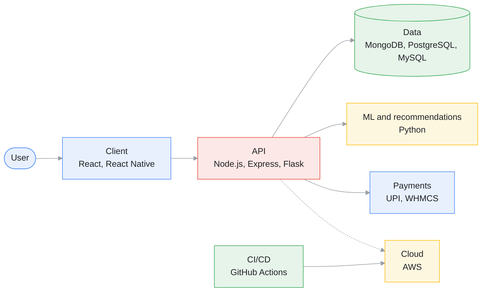

<!--
  Profile README for github.com/sauravsinhadev
  1) Repo must be PUBLIC and named exactly: sauravsinhadev  (sauravsinhadev/sauravsinhadev)
  2) Upload the assets/ folder (hero-light.svg, hero-dark.svg) to the repo root on branch "main"
-->

<picture>
  <source media="(prefers-color-scheme: dark)" srcset="https://raw.githubusercontent.com/sauravsinhadev/sauravsinhadev/main/assets/hero-dark.svg">
  <source media="(prefers-color-scheme: light)" srcset="https://raw.githubusercontent.com/sauravsinhadev/sauravsinhadev/main/assets/hero-light.svg">
  
</picture>

  
  
  
  

## About

Full-stack developer with **5+ years** of experience building products end to end: AI learning platforms, esports tournament systems, payment integrations and community-safety tools. I enjoy turning complex problems into simple, reliable software.

- **Building now:** [Queueezy](https://queueezy.in/), an AI-powered quiz and learning platform
- **Learning:** recommendation systems, embeddings and ranking
- **Open to:** internships, software engineering roles and collaboration <!-- edit this line to match what you want -->
- **Also:** open source contributor, tech writer and mentor

## Skills

<picture>
  <source media="(prefers-color-scheme: dark)" srcset="https://skillicons.dev/icons?i=python,js,java,mysql,react,html,css,bootstrap,nodejs,flask,express,mongodb,postgres,aws,git,githubactions&perline=8&theme=dark">
  <source media="(prefers-color-scheme: light)" srcset="https://skillicons.dev/icons?i=python,js,java,mysql,react,html,css,bootstrap,nodejs,flask,express,mongodb,postgres,aws,git,githubactions&perline=8&theme=light">
  
   
</picture>

| | |
|:--|:--|
| **Languages** | Python, JavaScript, Java, SQL |
| **Frontend** | React, HTML5, CSS3, Bootstrap |
| **Backend** | Node.js, Flask, Express, REST APIs |
| **Data** | MongoDB, PostgreSQL, MySQL |
| **Cloud and tooling** | AWS, Git, GitHub Actions |
| **Machine learning** | Recommendation systems, embeddings, similarity and ranking |

## Featured projects

<table>
<tr>
<td valign="top" width="50%">
<b><a href="https://queueezy.in/">Queueezy</a></b> &nbsp;🟡 In progress 
AI-powered quiz and learning platform for exam preparation.
<ul>
<li>Practice tests, leaderboards and performance analytics</li>
<li>User authentication and smart question recommendations</li>
</ul>
<code>AI</code> <code>Analytics</code> <code>Auth</code>
</td>
<td valign="top" width="50%">
<b><a href="https://fb.fairbattle.in/">Free Fire Tournament Platform</a></b> &nbsp;🟢 Live 
Complete esports tournament management for Free Fire.
<ul>
<li>Team registration, brackets and match scheduling</li>
<li>Result verification, prize tracking, leaderboards and an admin dashboard</li>
</ul>
<code>Full-stack</code> <code>Admin tools</code>
</td>
</tr>
<tr>
<td valign="top">
<b><a href="https://discord.com/discovery/applications/1329507405264060426">DarkSecurity</a></b> &nbsp;🟢 Live 
Security and moderation bot for Discord communities.
<ul>
<li>Anti-spam, anti-raid detection and auto moderation</li>
<li>Suspicious activity monitoring, audit logging and role management</li>
</ul>
<code>Discord</code> <code>Security</code> <code>Automation</code>
</td>
<td valign="top">
<!-- TODO: replace this link with the package's own repo or npm page -->
<b><a href="https://fb.fairbattle.in/">React Native AdMob Native Ads</a></b> &nbsp;🟢 Live 
React Native package for displaying AdMob Native Ads.
<ul>
<li>Full customization support</li>
<li>TypeScript-first design, built for React Native 0.85+</li>
</ul>
<code>React Native</code> <code>TypeScript</code>
</td>
</tr>
<tr>
<td valign="top">
<b><a href="https://github.com/sauravsinhadev/Recomendation">SynapseRec</a></b> &nbsp;🔵 Learning 
Recommendation engine built from scratch to learn the fundamentals.
<ul>
<li>Embeddings, similarity and session-aware recommendations</li>
<li>Ranking systems, built with AI as a learning partner</li>
</ul>
<code>Python</code> <code>Flask</code> <code>ML</code>
</td>
<td valign="top">
<b><a href="https://github.com/sauravsinhadev/ai-news-hub">AI News Hub</a></b> &nbsp;🟡 In progress 
AI-powered news aggregation app.
<ul>
<li>Personalized recommendations</li>
<li>Multilingual support</li>
</ul>
<code>AI</code> <code>Recommendations</code> <code>i18n</code>
</td>
</tr>
</table>

<b>More projects (7)</b>

 

| Project | What it does | Stack | Status |
|:--|:--|:--|:-:|
| [PaglaUPI WHMCS Gateway](https://github.com/sauravsinhadev/paglaupi-whmcs) | Custom WHMCS payment gateway with order verification, webhook handling and automated invoices. | `WHMCS` `Webhooks` | ⚪ Built |
| [UPI Payment SDK](https://github.com/sauravsinhadev/react-native-upi) | Google Pay, PhonePe and BHIM UPI workflows for React Native. | `React Native` `UPI` | ⚪ Built |
| [Discord Auto Shop Bot](https://github.com/sauravsinhadev/discord-auto-shop) | Automated digital product delivery with stock management and transaction verification. | `Discord` `Automation` | ⚪ Built |
| [AI Customer Support Chatbot](https://github.com/sauravsinhadev/ai-support-chatbot) | Chatbot for automated customer assistance and ticket handling. | `Node.js` `AI` | ⚪ Built |
| [Deal Discovery Platform](https://github.com/sauravsinhadev/deal-finder-ai) | Community deal sharing with AI recommendations and price tracking. | `AI` `Community` | 🟡 In progress |
| [Gama567 Mobile Platform](https://github.com/sauravsinhadev/gama567) | Android gaming app with responsive UI, authentication and real-time content delivery. | `Android` `Auth` | ⚪ Built |
| [Realtime Chat](https://github.com/sauravsinhadev/chats/tree/main) | WhatsApp-style realtime chat over socket connections. | `Sockets` `Realtime` | ⚪ Built |

🟢 Live &nbsp;·&nbsp; 🟡 In progress &nbsp;·&nbsp; 🔵 Learning &nbsp;·&nbsp; ⚪ Built

## What I’ve built

- **End-to-end products:** authentication, dashboards, admin tools, leaderboards and real-time features across web and mobile.
- **Payments:** UPI flows (Google Pay, PhonePe, BHIM) and a WHMCS gateway with webhook handling and automated invoicing.
- **Safety and automation:** moderation, anti-spam, anti-raid detection and audit logging for online communities.
- **Applied AI:** quiz recommendations, news personalization and a recommender explored from first principles.
- **Developer tooling:** a TypeScript-first React Native package published for other developers.

## How I build

## GitHub activity

<!--
  These cards use the public github-readme-stats and github-readme-activity-graph instances,
  which can show a rate-limit error at busy times. If that happens, delete this section;
  the rest of the page does not depend on it.
-->

<picture>
  <source media="(prefers-color-scheme: dark)" srcset="https://github-readme-stats.vercel.app/api?username=sauravsinhadev&show_icons=true&include_all_commits=true&hide_border=true&theme=transparent&title_color=8ab4f8&text_color=c9d1d9&icon_color=81c995">
  <source media="(prefers-color-scheme: light)" srcset="https://github-readme-stats.vercel.app/api?username=sauravsinhadev&show_icons=true&include_all_commits=true&hide_border=true&theme=transparent&title_color=1a73e8&text_color=3c4043&icon_color=188038">
  
</picture>
<picture>
  <source media="(prefers-color-scheme: dark)" srcset="https://github-readme-stats.vercel.app/api/top-langs/?username=sauravsinhadev&layout=compact&langs_count=6&hide_border=true&theme=transparent&title_color=8ab4f8&text_color=c9d1d9">
  <source media="(prefers-color-scheme: light)" srcset="https://github-readme-stats.vercel.app/api/top-langs/?username=sauravsinhadev&layout=compact&langs_count=6&hide_border=true&theme=transparent&title_color=1a73e8&text_color=3c4043">
  
</picture>

<picture>
  <source media="(prefers-color-scheme: dark)" srcset="https://github-readme-activity-graph.vercel.app/graph?username=sauravsinhadev&bg_color=0d1117&color=22d3ee&line=a78bfa&point=ff5fb0&area=true&area_color=7c3aed&hide_border=true&custom_title=Contribution%20graph">
  <source media="(prefers-color-scheme: light)" srcset="https://github-readme-activity-graph.vercel.app/graph?username=sauravsinhadev&bg_color=ffffff&color=7c3aed&line=0891b2&point=db2777&area=true&area_color=a78bfa&hide_border=true&custom_title=Contribution%20graph">
  
</picture>

<!--
  Optional: contribution snake. Needs snake.yml in .github/workflows/ (run it once from the Actions tab).

<picture>
  <source media="(prefers-color-scheme: dark)" srcset="https://raw.githubusercontent.com/sauravsinhadev/sauravsinhadev/output/github-snake-dark.svg">
  
</picture>

-->

## Let’s connect

I’m always happy to talk about engineering, internships and projects.

- **LinkedIn:** [linkedin.com/in/sauravsinhadev](https://linkedin.com/in/sauravsinhadev)
- **X / Twitter:** [@sauravsinhadev](https://twitter.com/sauravsinhadev)
<!-- - **Email:** add your real email here -->
<!-- - **Portfolio:** add your real site here -->

⭐ Explore my repositories, and don’t hesitate to reach out.
